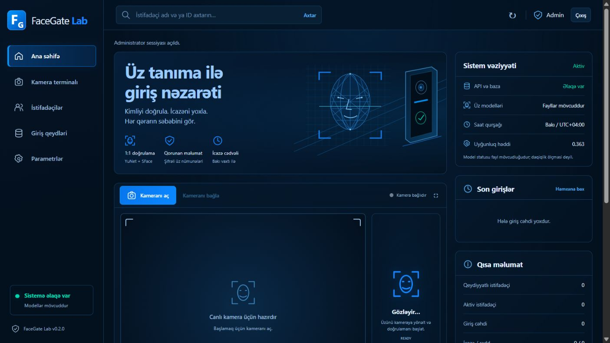

# FaceGate Lab

**A local facial-verification, access-policy and troubleshooting lab.** Python, OpenCV, FastAPI, encrypted biometric templates and a responsive Azerbaijani operator console.



## Nə edir?

İstifadəçi ID-sini bildirir → kamera kadrı həmin ID-nin üz nümunələri ilə müqayisə edilir → aktivlik, giriş nöqtəsi və Bakı vaxtı ilə cədvəl yoxlanır → qərar səbəbi ilə bazaya yazılır. Fiziki qapı açılmır.

- YuNet ilə üz aşkarlanması, SFace ilə **1:1 üz doğrulaması**.
- Üç fərqli kadrla qeydiyyat və bütün nümunə cütlərinin uyğunluq yoxlaması.
- Tək üz, minimum üz ölçüsü, bulanıqlıq və etibarlı rəqəmsal xüsusiyyət yoxlamaları.
- Aktiv/deaktiv hesab, icazəli giriş, gündüz və gecəni keçən saat cədvəli.
- Hadisələrin səbəb kodu, cosine similarity balı və server emal müddəti.
- İstifadəçi axtarışı, səhifələmə, hadisə filtrləri və görünən qeydlərin JSON ixracı.
- Ayrı qayda simulyasiyası: üz yoxlanmır, giriş hadisəsi yaranmır.
- Administrator girişi, müddətli sessiya, CSRF, loopback/origin yoxlaması və sürət limitləri.
- İstifadəçi ID-sinə bağlı şifrəli üz nümunələri və idarəetmə əməliyyatları jurnalı.
- Yoxlanılan hədd parametri, diaqnostika skripti və CCNA məşqləri.

## Başlat — Windows

[Lokal başlatma əmrləri və Cloudflare variantları](docs/local-and-cloudflare.az.md).

Bu kompüterdə virtual mühit və modellər hazırlanıb. **`start.cmd` faylını aç**, terminalda göstərilən lokal administrator açarını götür və [http://127.0.0.1:8000](http://127.0.0.1:8000) səhifəsində daxil ol. İşlək server varsa ikinci nüsxəni açma. Dayandırmaq: terminalda `Ctrl+C`.

Yeni kompüter üçün Python **3.12 və ya 3.13**, kamera və ilk quraşdırma üçün internet lazımdır. Layihə qovluğunda:

```powershell
.\setup.ps1
.\start.cmd
```

PowerShell skript icrası məhduddursa, sistemin icra siyasətini dəyişmədən:

```powershell
py -3.13 -m venv .venv
.\.venv\Scripts\python.exe -m pip install -r requirements.lock.txt
.\.venv\Scripts\python.exe scripts\download_models.py
.\start.cmd
```

`setup.ps1 -Python "C:\path\python.exe"` ayrıca Python yolu qəbul edir. Lokal `.venv` başqa kompüterə daşınmır. Modellər ilkin yükləmədən sonra lokal işləyir; şəkillər xarici tanıma xidmətinə göndərilmir.

Administrator açarını yenidən göstərmək:

```powershell
.\.venv\Scripts\python.exe scripts\admin_key.py
```

Açar `data/admin.key` faylındadır. Onu çata, issue-ya və ya GitHub-a göndərmə. Sessiya 30 dəqiqə autentifikasiyalı dəyişiklik edilməyəndə və ən gec 8 saatdan sonra bitir. Server restartı sessiyaları bağlayır; GET polling müddəti uzatmır.

## İlk praktik sınaq

1. **Kameranı aç**; brauzerin kamera icazəsini özün ver.
2. **Qeydiyyat**: `ST001`, adın, `Main-Gate`, `00:00 / 00:00` daxil et. Eyni vaxtlar bütün gün icazədir.
3. Razılığı təsdiqlə və üç ayrı kadr çək. Üzün aydın görünsün; kadrlar arasında azca hərəkət et.
4. Qeydiyyatı tamamla. **Doğrulama** bölməsində `ST001 / Main-Gate` ilə yoxla.
5. **İstifadəçilər** bölməsində hesabı deaktiv et və yenidən yoxla: `USER_DISABLED` gözlənilir.
6. Aktiv et, doğrulamada `Other-Gate` seç: `DOOR_NOT_ALLOWED` gözlənilir.
7. **Giriş qeydləri** bölməsində səbəbi, balı və müddəti araşdır.

Üz uyğun gəlməsi giriş icazəsi ilə eyni deyil. Foto/ekranla aldatmaya qarşı müdafiə yoxdur: bu sınaq tədris üçündür.

## Arxitektura

```text
Brauzer kamerası → düymə ilə kadr → localhost FastAPI
  → JPEG sərhədləri → YuNet → alignment → SFace embedding
  → ID-yə bağlı şifrəli nümunələrin açılması → cosine similarity
  → uyğunluq həddi → aktivlik / giriş / Bakı vaxtı ilə cədvəl
  → SQLite transaction → qərar + səbəb + müddət
```

Xam kadrlar bazaya yazılmır. Qeydiyyata qədər üç kadr brauzerin yaddaşında qalır. Üz vektorları da biometrik məlumatdır və qorunmalıdır. Şifrələmə açarı eyni kompüterdədir; kompüterə tam girişdən müdafiə deyil. Şəxsin adı, ID-si və hadisə metadatası açıq saxlanır.

Oxşarlıq balı faiz ehtimalı deyil. İlkin `0.363` həddi OpenCV-nin SFace nümunəsindən götürülüb; bu laboratoriyada dəqiqliyi kalibrasiya edilməyib. **Parametrlər** bölməsində dəyişiklik bütün sonrakı qeydiyyat və doğrulamalara təsir edir, bazada saxlanır və auditə yazılır. Ayrı test nümunələri ilə qiymətləndir.

## Yoxlama və inkişaf

```powershell
.\.venv\Scripts\python.exe -m pip install -r requirements-dev.lock.txt
.\.venv\Scripts\python.exe -m ruff check app scripts tests
.\.venv\Scripts\python.exe -m ruff format --check app scripts tests
.\.venv\Scripts\python.exe -m pytest -q
.\.venv\Scripts\python.exe scripts\model_smoke.py
.\.venv\Scripts\python.exe scripts\diagnose.py --admin
```

API və təhlükəsizlik sınaqları saxta üz mühərriki ilə izolyasiya edilir; real biometrik dəqiqliyi ölçmür. Model smoke testi həqiqi modelləri sintetik şəkillərlə yoxlayır. Canlı qeydiyyat, yanlış şəxs müqayisəsi və threshold kalibrasiyası ayrıca lazımdır. [Yoxlama qeydi](docs/validation.md).

GitHub Actions-də Python 3.12/3.13 testləri, lint/format və OSV dependency audit konfiqurasiyası var. Workflow-ların remote nəticəsi repo yüklənib işlədikdən sonra təsdiqlənə bilər.

## Öyrənmə materialları

- [Sabitləşdirilmiş rəsm, riyazi fiqur düzəltmə və real əşya analizi](docs/drawing-and-objects.az.md).
  Obyekt modelini quraşdırmaq üçün `.\.venv\Scripts\python.exe scripts\download_objects.py`.

- **Yeni: Jest laboratoriyası.** Kamerada əl nöqtələri, pinch ilə rəsm və seçim,
  jestlə kalkulyator, döndərilən kub/kürə/piramida. Kamera görüntüsü brauzerdə
  emal olunur; əl yazısı OCR və tənlik həlli yoxdur. Mövcud quraşdırmada əvvəl
  `.\.venv\Scripts\python.exe scripts\download_gestures.py` işə sal.
  [Quraşdırma, jestlər və məhdudiyyətlər](docs/gesture-lab.az.md).

- [Nəzəri və praktik plan](docs/learning-plan.az.md)
- [Nasazlıq laboratoriyası](docs/troubleshooting.az.md)
- [CCNA şəbəkə laboratoriyası](docs/network-lab.az.md)
- [API və arxitektura](docs/architecture.md)
- [Təhlükəsizlik sərhədləri](SECURITY.md)
- [Dəyişikliklər](CHANGELOG.md) və [töhfə qaydaları](CONTRIBUTING.md)

Kodu bu ardıcıllıqla oxu: `rules.py` → `storage.py` → `vision.py` → `security.py` → `main.py` → `web/app.js` → `tests/`.

## GitHub-a private yerləşdirmək

Hazır lokal Git reposundan, hesab girişini özün tamamladıqdan sonra:

```powershell
gh auth login -h github.com -p https -w
.\publish-private.ps1
```

Skript repo görünürlüğünü yoxlayır, yalnız private repo üçün işləyir və force push etmir. `.gitignore` baza, açar, model, virtual mühit və cache fayllarını istisna edir. Yenə də `git status --short` ilə paylaşılacaq faylları yoxla. Mənbə ZIP-i bu lokal məlumatları daşımır.

## Məhdudiyyətlər

Yalnız etibarlı, bir administratorlu lokal laboratoriya. LAN-a və internetə açma. PAD/liveness, şəxsiyyətin rəsmi təsdiqi, real turniket/kontroller, 1:N identifikasiya və paylanmış çox-worker iş rejimi yoxdur. Ölçülməmiş dəqiqlik və sürət iddiaları verilmir. İdarəetmə jurnalı dəyişdirilməz audit sistemi deyil.

İstifadəçi silinməsi üz nümunələri və əlaqəli giriş hadisələrini silir; psevdonimləşdirilmiş idarəetmə qeydi qalır. Bu, SSD və köhnə backup-lardan forensik silinmə zəmanəti deyil. v0.1 açıq nümunələri startup zamanı şifrələnir; köhnə backup-ları ayrıca qoru.

## Mənbələr və lisenziya

- [OpenCV üz aşkarlanması və tanınması](https://docs.opencv.org/4.x/d0/dd4/tutorial_dnn_face.html)
- [Model mənbələri və lisenziyaları](models/README.md)
- [FastAPI](https://fastapi.tiangolo.com/tutorial/)
- [Cryptography / Fernet](https://cryptography.io/en/latest/fernet/)

Orijinal layihə kodu MIT lisenziyası altındadır. Modellər və kitabxanalar öz lisenziyalarını saxlayır.

## Anonim canlı müşahidə

Menyudan **Canlı müşahidə → Kameranı başlat** seç. OpenCV YuNet bütün aşkarlanan üzləri yaşıl çərçivədə göstərir; Kalman hərəkət izləməsi müvəqqəti **Person #** nömrələri verir. Yeni izləmə üçün bir bildiriş, canlı üz sayı, ilk və son görünmə Bakı vaxtı ilə göstərilir. Analiz təxminən 6 dəfə/saniyə hədəfləyir, cihaz sürətinə uyğunlaşır. 1,5 saniyəlik qısa fasilələr eyni nömrə ilə davam edə bilər. Üzlər müqayisə edilmir, kadrlar və biometrik nümunələr saxlanmır. Son 500 metadata qeydi cari kamera sessiyasında qalır; yenidən başlatmadan əvvəl CSV endir. Fiziki giriş-çıxış və unikal insan sayı ölçülmür.

[İcra, arxitektura, dəyişən fayllar və test addımları](docs/anonymous-tracking.md).

## Telegram bildirişləri və AR əlavələri

Canlı YOLO insan/obyekt izləməsi, müvəqqəti nömrələr, say və görünmə vaxtları, istəyə bağlı kamera şəkli ilə Telegram bildirişləri mövcuddur. İnsan rejimində təkrar şəkil fasiləsi 60 saniyədir; çıxış mesajı şəkilsizdir. [Quraşdırma, saxlama və test təlimatı](docs/telegram-watch.az.md).

Jest laboratoriyası iki əlin izlənməsi, sabit jest keçidləri, əl/divar AR effektləri, barmaq sayı ilə POLAD yazılması və Three.js/cannon-es telekinez rejimini ehtiva edir. Bunlar kamera üzərində virtual effektlərdir. `web/vendor/` kitabxanalarının lisenziyaları həmin qovluqdadır.

## Telefon inteqrasiyası — cari vəziyyət

Telefondan canlı kamera baxışı Tailscale üzərindən özəl HTTPS, birdəfəlik kod və kompüterdə təsdiq ilə prototipləşdirildi. Şəbəkə gecikməsi zamanı müşahidə edilən donmalar üçün davamlı multipart JPEG axını, yalnız son kadrın saxlanması, yenidən qoşulma və köhnə kadrların gizlədilməsi sınaqdan keçirildi. Bu prototip layihənin əhatəsini sadələşdirmək üçün **cari versiyadan çıxarılıb**. Yerli OpenCV/YOLO analizi və istəyə bağlı Telegram hadisə şəkilləri ayrıca funksiyalar kimi qalır.

Telefonun ayrıca **paylaşılan yazı/rəsm lövhəsi** kamera və kompüter idarəsi vermir. `start-control.cmd` ilə lövhə xidmətini başlat, `http://127.0.0.1:8011` panelindən telefonu qoşalaşdır və yazı icazəsini təsdiqlə. [Lövhənin quraşdırılması](docs/secure-control.az.md).

[English overview](README.en.md) · [İşin texniki izahı — AZ](docs/engineering-notes.az.md) · [Engineering notes — EN](docs/engineering-notes.en.md)
